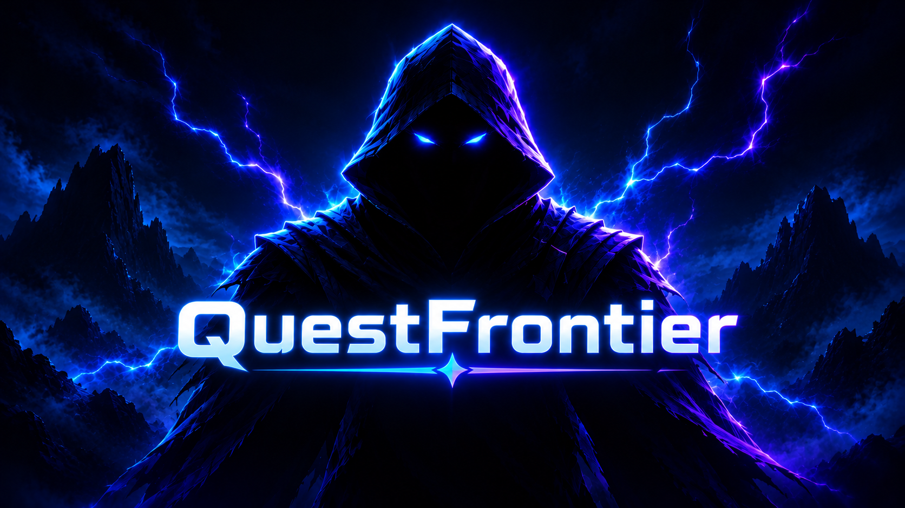

# QuestFrontier

**Make progress feel like an adventure.**

QuestFrontier turns personal goals and everyday routines into quests. Set a clear objective, choose when and how often to work on it, then build momentum by completing what you set out to do.

## Turn Goals Into Quests

Create quests for the things you want to accomplish. Add details, choose a difficulty, and set a deadline. For habits and repeating goals, use recurring quests to give your routine a regular place in your day.

## Grow With Every Completion

Completing quests earns experience and coins. Build levels, keep a streak alive, and use your profile stats to see how your effort adds up over time. Badges and shop items give you more milestones to work toward along the way.

## Stay Accountable

Deadlines make priorities visible, while penalties and blocked-app rules help you set boundaries around distractions. QuestFrontier brings your goals, progress, and rewards together so you can focus on the next step.

## Your Quest Loop

1. Choose a goal that matters to you.
2. Turn it into a quest with a difficulty and deadline, or make it recurring.
3. Work on the quest and mark your progress as you go.
4. Earn rewards, review your stats, and choose what to tackle next.
